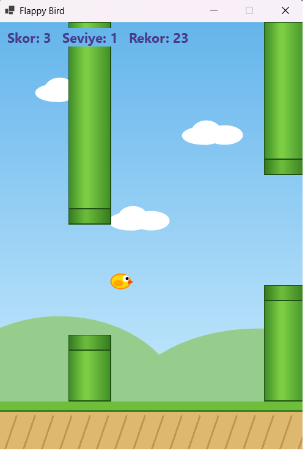
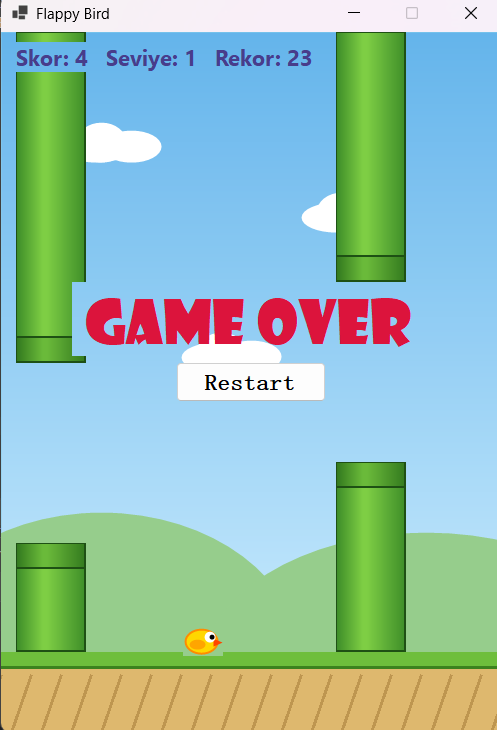

# YMH219-FlappyBird

Windows Forms ile geliştirilmiş, Flappy Bird benzeri bir masaüstü oyunu.
Nesne Tabanlı Programlama dersi 3. ödevi olarak hazırlanmıştır.

## Projenin Amacı

Zamanlayıcı (Timer) ve klavye olaylarını kullanarak görsel bileşenleri çalışma
zamanında hareket ettirmek, çarpışma kontrolü yapmak ve oyun durumunu nesne
tabanlı bir yapı ile yönetmek.

## Kullanılan Teknolojiler

- C#
- .NET 10
- Windows Forms
- Visual Studio Community 2026
- Git / GitHub

## Oyun Nasıl Oynanır?

- **Space** tuşu: Kuşu zıplatır.
- Kuş boruların arasındaki boşluktan geçmelidir.
- Her geçilen boru 1 puan kazandırır, her 5 puanda seviye artar ve oyun hızlanır.
- Boruya veya zemine çarpınca oyun biter. **Restart** düğmesiyle yeniden başlanır.

## Ek Özellikler (İsteğe Bağlı Geliştirmeler)

- **En yüksek skor:** Rekor `highscore.txt` dosyasında saklanır, oyun kapatılıp açılsa da korunur.
- **Seviye sistemi:** Her 5 puanda seviye artar, borular hızlanır.
- **Ses efektleri:** Puan alınca ve çarpınca sistem sesi çalar. **M** tuşu sesi açıp kapatır.
- **Kodla çizilen görseller:** Kuş, borular, zemin ve arka plan `SpriteFactory` sınıfı ile çizilmiştir.

## Sınıf Yapısı

- `Bird`: Kuşun konumu, hızı, yerçekimi ve zıplama.
- `Pipe`: Üst/alt boru, hareket, çarpışma ve yeniden konumlandırma.
- `GameState`: Skor, seviye, oyun hızı ve oyunun bitip bitmediği.
- `Form1`: Timer döngüsü, klavye olayları ve oyun akışı.
- `HighScoreStorage`: En yüksek skorun dosyaya yazılması ve okunması.
- `SpriteFactory`: Oyun görsellerinin kodla çizilmesi.

## Çalıştırma Adımları

1. Depoyu klonlayın:
   `git clone https://github.com/ulkutuanna/YMH219-FlappyBird.git`
2. `YMH219-FlappyBird.sln` dosyasını Visual Studio ile açın.
3. **F5** tuşuna basarak çalıştırın.

## Ekran Görüntüleri

## Hazırlayan

[Ad Soyad] - [Öğrenci No]